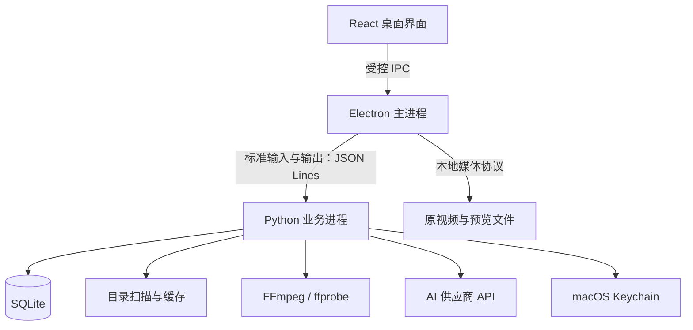

# FrameLedger · 帧账本

A local-first AI video asset manager with smart tagging, search, and token usage and cost tracking.

面向个人创作者的本地 AI 视频资产管理工具：把不断增长的视频素材整理成可浏览、可搜索的资产库，并记录 AI 分析产生的 Token 用量与成本。

**项目状态：规划阶段。当前仓库包含技术选型与开发路线，尚未提供可运行的软件。下文描述的是计划能力与实现顺序。**

**架构决策记录**：[ADR 0001：本地桌面应用的初始架构](docs/adr/0001-local-desktop-architecture.md)——记录选型依据、接受的代价与重新评估条件。

## 1. 产品目标

FrameLedger 首先解决三个问题：素材越来越多，难以找到；生成来源与提示词分散，难以复用；AI 调用不断发生，难以知道钱花在哪里。

第一版面向单人使用，优先支持 **macOS Apple Silicon（arm64）**。采用 Web 风格的桌面界面，使用 TypeScript 构建交互，使用 Python 承担业务逻辑与 AI 接入。

### 第一版包含什么

- 导入本地目录，建立视频索引，浏览缩略图、播放预览、查看元数据。
- 按项目、标签、收藏和文本搜索组织素材。
- 记录生成工具、模型、提示词、来源和相关素材；支持手动补充与修改。
- 对选中的素材执行 AI 分析，生成可编辑的中文标签和摘要。
- 按素材、项目、模型和日期统计 AI 用量与成本。
- 查看后台任务进度，管理缓存，备份数据库，重新定位移动后的素材。

### 第一版的边界

- **原位索引**：导入目录不搬走或复制原视频。原素材继续位于用户现有目录或外接硬盘。
- **本地优先**：素材目录、索引、标签、账本和缓存保存在本机；AI 分析由用户触发，选定的抽帧与必要文本会发送到配置的供应商。
- **自用成本统计**：这里的 Token 计费是个人使用成本账本，不包含用户钱包、充值、订阅或支付。
- **先管理已有素材**：视频生成、剪辑时间线、多人协作、云同步和 Windows 分发不属于第一版。
- **基础搜索先完成**：先搜索文件名、标签、提示词和摘要；向量检索与相似素材推荐在后续加入。

## 2. 技术栈

| 层次 | 选型 | 用途与选择理由 |
| --- | --- | --- |
| 桌面容器 | Electron | 窗口、系统菜单、目录选择、媒体访问和 Python 进程生命周期 |
| 界面 | React + TypeScript + Vite | 素材网格、详情面板、任务中心和费用看板；使用类型约束跨模块数据 |
| UI 组件与样式 | Tailwind CSS + [shadcn/ui](https://ui.shadcn.com/docs/installation/vite) | 复用表单、对话框、表格等组件，统一视觉风格 |
| 界面状态 | Zustand | 管理选中项、筛选条件和交互状态；SQLite 中的数据仍是业务事实来源 |
| 大列表 | [TanStack Virtual](https://tanstack.com/virtual/latest/docs/introduction) | 按可见区域渲染资产网格，配合数据库分页与缩略图懒加载 |
| 业务层 | Python + [uv](https://docs.astral.sh/uv/) + Pydantic | 资产服务、任务执行、AI 接入、数据校验和 Python 依赖管理 |
| 本地数据库 | SQLite + Python 标准库 sqlite3 | 保存资产、标签、任务、分析结果、价格和用量；使用编号 SQL 迁移 |
| 文本检索 | SQLite FTS5 + 子串查询 | 检索标签、摘要和提示词；单独处理中文短查询 |
| 媒体处理 | FFmpeg + ffprobe | 提取时长、编码和分辨率，生成缩略图、分析抽帧和播放代理 |
| AI 接入 | Python 供应商适配层 | 封装供应商 SDK 或 HTTP API，统一结果与用量；第一版只接入一个实际使用的供应商 |
| 成本计算 | Python Decimal | 用十进制计算费用，按调用时价格快照生成可追溯记录 |
| 密钥保存 | Python keyring + macOS Keychain | 保存用户自己的 API Key，普通设置只保存凭据引用 |
| 应用打包 | Electron Forge + PyInstaller onedir | 将 Electron、Python worker 及媒体工具放入可独立运行的应用包 |
| 开发检查 | pytest + Vitest + Ruff + ESLint | 验证 Python 业务、前端逻辑、代码风格及类型 |

开发阶段使用 npm 管理前端依赖、uv 管理 Python 依赖，并提交各自的锁文件。具体版本在工程初始化时选取相互兼容的稳定版本并锁定，本规划不把未来可能变化的版本号写死。

Electron 提供 Chromium 与 Node.js 运行环境；PyInstaller 可以将 Python 解释器和依赖一起打包。混合方案需要维护进程通信和两套构建，因此第一阶段就验证完整安装包。[Electron 文档](https://www.electronjs.org/docs/latest/)、[PyInstaller 打包说明](https://www.pyinstaller.org/en/stable/operating-mode.html)

## 3. 整体架构



### 模块职责

| 模块 | 职责 |
| --- | --- |
| React 界面 | 展示、筛选、编辑、任务进度及错误反馈 |
| Electron 主进程 | 窗口与系统能力、文件选择、受控媒体读取、启动和关闭 worker |
| Python 资产服务 | 目录索引、元数据、标签、项目、来源信息、素材重新定位 |
| Python 媒体服务 | ffprobe 探测、缩略图、抽帧、按需生成预览代理 |
| Python 任务服务 | 持久化任务、调度、限制并发、取消、恢复和失败处理 |
| Python AI 服务 | 供应商适配、分析结果校验、人工修订保存、后续检索扩展 |
| Python 费用服务 | 用量归一化、价格快照、成本计算、分类汇总与导出 |

Python 是业务数据库的唯一写入方；数据库操作经统一存储层串行化写入。React 通过 preload 暴露的窄接口调用业务，不直接访问数据库、文件系统或 API Key。

Electron 与一个常驻 Python worker 通过 JSON Lines 通信。请求携带请求 ID、操作名和参数；响应携带结果或错误；长任务先返回任务 ID，再推送进度。stdout 只输出协议消息，日志走 stderr。协议使用 UTF-8，接收端按换行缓冲解析，支持取消和进程异常反馈。

通信只传路径、元数据、进度和结果，视频内容不经 JSON Lines 搬运。媒体预览通过 Electron 的受控本地协议读取，支持播放所需的范围请求。先验证 MP4/H.264 样本；不能直接播放的素材按需生成代理文件，并保留原视频。

### 主要数据流

1. **导入**：选择目录 → 扫描文件 → 登记资产 → ffprobe 提取元数据 → 排队生成缩略图 → 更新界面。
2. **AI 整理**：选择素材 → 查看分析范围与费用估算 → 提交分析 → 抽帧 → 调用模型 → 保存摘要、标签和实际用量 → 更新成本。
3. **搜索**：输入文本与筛选条件 → 查询本地索引 → 分页返回资产 → 按需读取缩略图和预览。

抽帧描述反映所采样画面的内容，不能当作逐帧完整理解；保存抽帧时间点以便用户核对。AI 建议和用户修订分开保存，再次分析不自动覆盖人工修改。

### 规划目录

以下为后续代码结构，目前尚未创建：

```text
frameledger/
├── README.md
├── desktop/
│   ├── main/              # Electron 主进程与 worker 桥接
│   ├── preload/           # 界面可用的受控接口
│   └── renderer/          # React 界面与组件
├── backend/
│   ├── frameledger/
│   │   ├── assets/        # 资产、项目、标签与来源信息
│   │   ├── media/         # 元数据、缩略图、抽帧与代理
│   │   ├── jobs/          # 持久任务队列与调度
│   │   ├── ai/            # 供应商适配与结果处理
│   │   ├── ledger/        # 用量、价格与费用
│   │   ├── storage/       # SQLite 访问及迁移
│   │   └── ipc/           # JSON Lines 请求与事件
│   └── tests/
├── contracts/             # 跨语言协议说明、示例与契约测试数据
└── packaging/             # Forge、PyInstaller 与媒体资源打包配置
```

数据库、日志和缓存放在应用的用户数据目录，不写入安装包或源码仓库。原视频按引用路径读取；“从库中移除”仅移除索引。数据库备份包含索引、标签、任务和账本，不等于备份原视频。

## 4. 数据与 Token 成本设计

### 需要保存的数据

| 数据对象 | 关键内容 |
| --- | --- |
| 资产与位置 | 稳定资产 ID、所属素材根目录、相对路径、大小、修改时间、时长、编码、分辨率、可用状态 |
| 项目与标签 | 项目归属、标签、收藏、用户备注 |
| 来源与生成信息 | 工具、模型、提示词、来源、生成时间、关联素材；未知信息保留为空 |
| 衍生文件 | 缩略图、抽帧时间点、预览代理、缓存位置与对应素材版本 |
| 任务与分析 | 类型、状态、进度、尝试次数、输入版本、AI 输出和人工修订 |
| 调用与用量 | 应用调用 ID、供应商请求 ID、模型、任务、资产、用量维度、结果状态 |
| 价格与费用 | 价格单位、币种、生效时间、价格来源、调用时快照、金额与确认程度 |

同一路径重复导入应更新已有索引；文件修改后使旧缩略图和分析结果标记为需要更新。第一版不靠全量视频哈希阻塞导入；跨路径的内容去重留到后续。

### 成本计算原则

“实际用量”不等于“供应商最终账单”。界面分别展示：

- **调用前估算**：根据可获得的 Token 计数或供应商规则估计，并标明估算依据；无法估算时显示未知。
- **按实际用量计算的成本**：使用响应中的 usage 与调用时价格快照计算。
- **供应商确认费用**：仅在获得供应商费用数据或人工对账记录后标记，并保存来源。

最简单的纯文本计费可以表示为：

```text
成本 = 输入 Token × 每百万输入 Token 单价 / 1,000,000
     + 输出 Token × 每百万输出 Token 单价 / 1,000,000
```

实际接入时按供应商定义拆分普通输入、缓存输入、输出、图像、音频或其他收费项。只相加互不重叠的收费量，不能把已经包含在输入或输出总量里的缓存、推理 Token 再收一遍。也不能用文本 Token 公式替代全部视频或音频计价。

- 使用 Decimal 从字符串构造金额，SQLite 保存十进制字符串和币种，避免经过二进制浮点转换。
- 保存调用时的价格快照；以后更新价格，不重算历史账目。
- 缺少用量或价格时显示未知；如果只有部分费用可计算，显示已知部分和未覆盖项。
- 不同币种分别汇总，第一版不自动换汇。
- 同一调用的重复结果只结算一次；真正发起的新请求按独立调用记录。
- 超时后仍可能发生费用；结果未知的付费调用不自动重发，保留待核对状态。
- 已有视频的历史生成成本只记录可靠导入或手动填写的数据，不从文件大小、提示词长度反推。
- 第一版提供月度或项目预算提醒，不把本地提醒承诺为供应商侧的硬性扣费上限。

API Key 存入系统凭据库，不写入 README、数据库普通字段、请求日志或 Git。成本计算参考 [Python Decimal 文档](https://docs.python.org/3/library/decimal.html)，凭据接入参考 [keyring 文档](https://keyring.readthedocs.io/en/stable/)。

## 5. 分阶段开发路线

按下面顺序完成，每阶段以可演示成果验收后再进入下一阶段。先打通一条完整链路，再扩展界面和功能。

| 阶段 | 要做什么 | 阶段验收成果 |
| --- | --- | --- |
| 1. 工程骨架与打包闭环 | 初始化 Electron、React、TypeScript 和 Python 工程；实现 ping、读取单个视频信息、SQLite 写入；打包 Python 与 FFmpeg | 从 Finder 启动 arm64 应用，选择视频后得到元数据，不依赖系统 Python、Homebrew 或开发目录 |
| 2. 资产入库 | 建立数据库与迁移；支持目录递归扫描、原位索引、元数据提取、重复导入更新与缺失状态 | 导入一个真实素材目录，重启应用后仍可浏览元数据；再次导入不会生成重复索引 |
| 3. 浏览与基础搜索 | 实现侧栏、虚拟化网格、详情面板、缩略图、播放、标签、项目、收藏和文本搜索 | 能通过名称、中文标签、提示词或摘要找到素材，筛选和翻页不加载全量视频 |
| 4. 持久后台任务 | 将导入与媒体处理接入 SQLite 队列；提供进度、取消、失败信息和恢复；媒体与 AI 分别限制并发 | 批量导入时界面可操作；关闭并重开后任务有明确状态；外接盘离线时可暂停并重新定位 |
| 5. AI 分析与用量入账 | 选择并验证一个可用的多模态供应商；配置模型和凭据；实现抽帧、标签、摘要、结果编辑；每次调用同步记录 usage 和价格快照 | 对一段视频完成分析，得到可编辑结果，并能追溯到同一次模型请求的用量与成本状态 |
| 6. 成本看板与导出 | 按日期、模型、项目、素材汇总；配置价格与预算；展示估算和未知项；导出 CSV 账本 | 能回答某个项目花了多少、哪些素材成本最高、哪些请求仍需核对 |
| 7. 自用版本完善 | 加入数据库备份恢复、缓存清理，完善重新定位；完成规模测试和打包回归 | 安装后的应用独立完成导入、预览、分析和记账，能够持续管理真实素材库 |

### 各阶段的实现要点

**阶段 1：先验证混合技术栈能交付。** 将 Python worker 的完整 onedir 目录与 FFmpeg/ffprobe 放入应用的真实资源目录，通过绝对路径启动。不要只复制 worker 的单个入口文件，也不要从 ASAR 内直接运行外部可执行程序。确认可执行权限、依赖架构、必要的应用签名和 Finder 启动环境；关闭应用时回收 worker 与其媒体子进程。[Electron ASAR 限制](https://www.electronjs.org/docs/latest/tutorial/asar-archives)、[Forge 资源配置](https://js.electronforge.io/interfaces/_electron-forge_shared-types.ForgePackagerOptions.html)

**阶段 2—3：先建立好用的本地素材库。** ffprobe 负责读取媒体信息，FFmpeg 负责生成展示资源。采用分页查询、可见区域渲染和有界图片缓存。路径中的中文、空格以及外接盘根目录变化都要覆盖。[ffprobe 文档](https://ffmpeg.org/ffprobe.html)、[FFmpeg 文档](https://ffmpeg.org/ffmpeg.html)

**中文搜索需要明确策略。** 使用 FTS5 trigram 处理至少三个字符的子串匹配，一至两个字符使用转义后的 LIKE 子串查询；结构化标签、项目和日期走普通索引。确认打包后的 SQLite 包含 FTS5，并实测短查询性能。[SQLite FTS5 文档](https://www.sqlite.org/fts5.html)

**阶段 4：让任务状态可解释。** 保存 queued、running、succeeded、failed、cancelled、interrupted 等状态。重启后把未完成的 running 任务标记为 interrupted；本地可重做任务允许恢复，结果未知的 AI 调用转入待核对。先采用保守的有界并发，再根据实际硬件测试调整。

**阶段 5：AI 能力与账本一起接入。** 先完成一个供应商、一种视频分析流程。适配器返回标签、摘要、原始 usage 字段和归一化用量，不假设所有供应商的接口与收费字段完全相同。首版不加载本地大模型；抽帧、分辨率与单次分析范围应有上限，并展示本次要提交的内容。

**阶段 6—7：用真实使用记录完善产品。** 做预算提醒、费用导出、数据库备份和缓存清理。预览代理按需生成；缓存可重建，清理缓存不删除原素材。对外公开分发时，再完成对应的签名、公证及所分发依赖的许可说明。

### 建议学习顺序

1. TypeScript 基础与 React：组件、状态、表单、异步交互。
2. Electron：主进程、渲染进程、preload、IPC 和打包。
3. Python 工程化：uv、Pydantic、模块边界、pytest。
4. SQLite 与媒体工具：迁移、索引、分页、ffprobe、FFmpeg 子进程。
5. AI API 与成本统计：多模态输入、usage、限流、价格快照、Decimal。

学习与对应开发阶段同步进行，不必先学完整个技术栈再动手。

## 6. 验收与测试清单

| 场景 | 验证内容 |
| --- | --- |
| 导入与索引 | 中文、空格路径；重复导入；文件修改；无法读取和损坏的视频 |
| 文件位置 | 外接盘断开、恢复连接、目录迁移后重新定位；不删除原素材 |
| 预览 | 实际素材的编码兼容性；缩略图生成；代理播放；缓存清理后的重建 |
| 任务 | 取消、失败、worker 崩溃和应用重启；无遗留 FFmpeg 进程 |
| AI 结果 | 正常返回、结果结构不完整、限流和超时；人工修改不会被重新分析覆盖 |
| 成本 | 价格变化、缓存费用、部分用量、未知费用、重复回调、重试产生的新调用与不同币种 |
| 通信 | UTF-8、拆分消息、连续多条消息、并发请求对应关系和进程退出 |
| 规模 | 一万条资产元数据作为初始基线；检查分页、网格滚动、搜索、缓存占用和批量处理进度 |
| 备份与安装 | 数据库恢复；从 Finder 启动；不依赖开发机环境的完整业务链路 |

业务测试优先覆盖索引更新、任务状态和费用计算。使用固定响应样例测试 AI 与账本，日常自动测试不消耗真实 API 额度；供应商接入验收时再执行少量真实请求。前端测试覆盖筛选、详情编辑和任务状态显示，安装包另做实际媒体验收。

一万条元数据是初始测试规模，不代表已通过性能验证，也不意味着需要一万份视频副本。开发时记录测试机器、素材分布、耗时和内存表现，再确定可发布的性能指标。

## 7. 后续扩展

- **语义搜索**：为摘要与标签建立向量索引，结合文本筛选做自然语言检索；记录 embedding 成本。
- **相似素材与去重**：在基础索引稳定后，引入内容指纹或视觉特征，不阻塞首次导入。
- **音频与转写**：加入语音转写及时间定位，并按对应计费单位记录费用。
- **视频生成工作流**：提交生成任务、下载结果、关联提示词与版本，并单独记录生成费用。
- **更多平台**：先扩展 Windows，分别验证路径、凭据存储、媒体兼容和安装包。
- **商业化**：如果以后向用户收费，再独立设计账户、服务端可信账本和支付系统，不把可修改的本地数据库当作收款依据。

## 8. 当前进度

- [x] 确定项目名称与首版边界。
- [x] 确定技术栈、进程职责和成本记录原则。
- [x] 编写阶段路线与验收清单。
- [ ] 完成阶段 1：最小工程与打包闭环。
- [ ] 完成阶段 2—4：可用的本地素材库。
- [ ] 完成阶段 5—6：AI 整理与费用看板。
- [ ] 完成阶段 7：可长期自用的 macOS 版本。

下一步从“启动桌面窗口 → 启动 Python worker → 读取一段本地视频元数据 → 打包后重复验证”开始。
